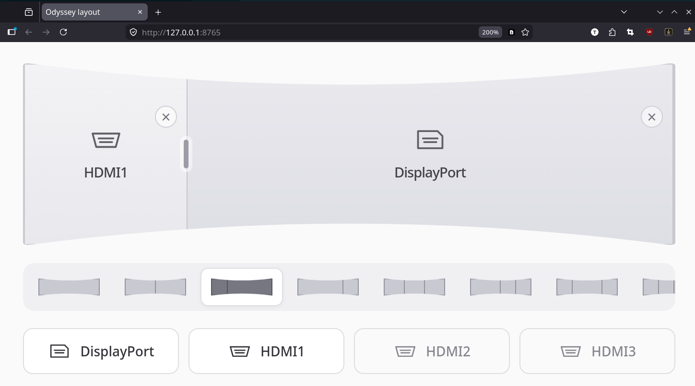

# G95NC monitor service

A local HTTP API and web layout editor for the Samsung 57-inch Odyssey Neo G9
G95NC. Arrange DisplayPort and HDMI inputs, choose a split, and confirm to apply
it. Supports full screen, two- and three-pane PBP layouts, and PiP.



## Requirements

- **Minimum supported firmware: M-C9557GGPA-1009.2.** This is the verified
  version; earlier firmware is unverified. Tested on model LS57CG952NEXXY.
- Linux with Python 3.11+, systemd user services, and `/usr/bin/ddcutil`.
- DDC/CI access to the monitor as your normal user. Tested on Fedora over
  DisplayPort; other connection paths are unverified.

## Build and install

No compilation, Python packages, or frontend build step is needed. The service
uses Python's standard library and serves plain HTML, CSS, and JavaScript.

On Fedora, install the dependencies and find your monitor's serial:

```bash
sudo dnf install python3 ddcutil
ddcutil detect
```

Ensure `ddcutil detect` can access the monitor without sudo before continuing.
From this repository, install as your desktop user:

```bash
python3 deploy/install.py --serial YOUR_MONITOR_SERIAL --start
```

Open <http://127.0.0.1:8765>. Get your login token with:

```bash
cat ~/.config/g95nc/token
```

The browser remembers the token in local storage after login. The service listens
on localhost by default. Configuration and credentials live in `~/.config/g95nc`,
and the installed application lives in `~/.local/share/g95nc`.

Re-run `python3 deploy/install.py --start` to update the installed copy; existing
configuration and credentials are preserved. Optional `--serial`, `--host`, and
`--port` arguments override those settings.

```bash
systemctl --user status g95nc
systemctl --user restart g95nc
journalctl --user -u g95nc -f
systemctl --user disable --now g95nc
```

The service normally starts at login. For development, stop the installed
service and run the checkout with the same configuration:

```bash
systemctl --user stop g95nc
python3 service.py --config ~/.config/g95nc/config.json
```

## How it works

The browser sends layout requests to the Python HTTP service, which uses
`ddcutil` to send DDC/CI commands through the display connection. Samsung's
vendor VCP registers `E2` and `E3` control PBP/PiP layout and pane sources;
standard register `60` selects the full-screen input.

A single worker serializes monitor operations. Every complete layout change
sets and verifies the mode **before** assigning inputs. Two-pane reversals use
the monitor's native swap command. Other changes use individual source writes,
with spare inputs to avoid duplicates when current assignments can be decoded.
The service polls monitor state every 30 seconds and never reapplies layouts
on startup or reconnect. UI edits remain drafts until Confirm.

Mode and input changes are separate monitor commands, so transitions can take
several seconds. Three-pane source readback is not fully decoded: those changes
report readback-only verification. Failed operations can leave a partially
applied layout; there is no automatic rollback. Information comes from the
monitor, with no connected-device telemetry or screen capture.

## HTTP API

All `/v1/*` endpoints require `Authorization: Bearer TOKEN`. GET reads state;
POST changes the monitor. POST returns `202` with a job ID and `status_url`;
poll that URL until the job is `succeeded` or `failed`. Busy operations return
`409`. Jobs are kept in memory and reset when the service restarts.

| Method | Endpoint | Purpose |
| --- | --- | --- |
| GET | `/v1/status` | Cached monitor state and service statistics |
| GET | `/v1/monitor` | Fresh monitor state |
| GET | `/v1/layouts` | Available layouts and inputs |
| POST | `/v1/layout` | Apply a complete layout and input assignment |
| GET | `/v1/vcp` | Register catalog |
| GET | `/v1/vcp/{code}` | Read `E2`, `E3`, or `60` |
| POST | `/v1/vcp/E2` | Send a mode command, e.g. `{"value":"0x03"}` |
| GET | `/v1/presets` | Available presets |
| POST | `/v1/presets/{name}` | Apply a preset |
| GET | `/v1/jobs/{id}` | Job progress, result, and verification |

For example, apply 50/50 with HDMI1 left and DisplayPort right:

```bash
G95NC_TOKEN="$(cat ~/.config/g95nc/token)"
curl http://127.0.0.1:8765/v1/layout \
  -H "Authorization: Bearer $G95NC_TOKEN" \
  -H 'Content-Type: application/json' \
  -d '{"profile":"50-50","inputs":["HDMI1","DisplayPort"]}'
```

Input-only writes to `E3` and `60` are rejected: use `/v1/layout` to preserve
mode-before-input ordering.

## Tests

```bash
python3 -m unittest discover -s tests -v
node --check web/app.js
```

Python tests use fake monitor replies and do not change real hardware. Node.js
is only needed for the optional JavaScript syntax check.
